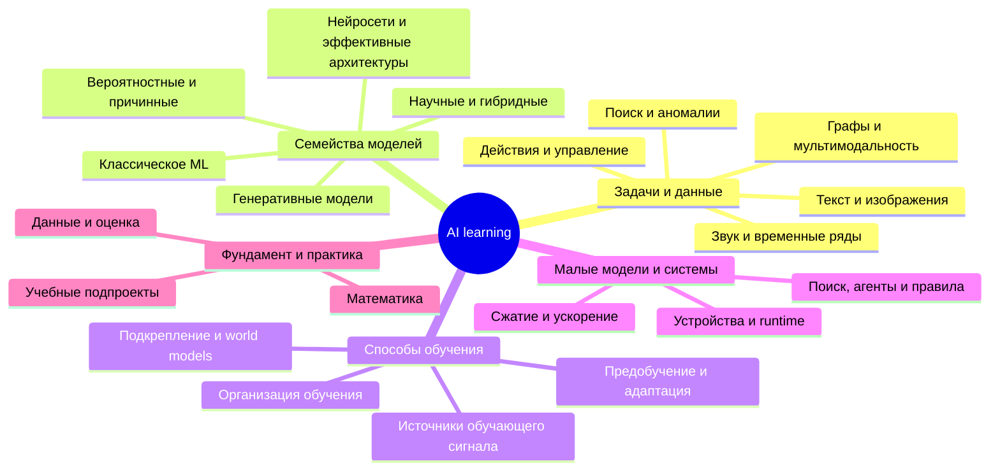

# AI learning — карта знаний и учебная лаборатория

Широкая карта основных областей AI и машинного обучения для выбора своих учебных проектов. Срез источников: **24 октября 2026 года**. Это обзор семейств, а не обещание перечислить каждую публикацию или каждую архитектурную вариацию.

Архитектура, задача, способ обучения и оптимизация — разные оси. Например: **картинки → CNN → self-supervised pretraining → fine-tuning → INT8 → локальное приложение**. Поэтому ветки карты пересекаются.

## Как читать карту

- **Практика** — метод имеет рабочие применения; это не гарантия выигрыша в любой задаче.
- **Исследование** — интересный путь для экспериментов, но не обещание готовой замены обычным методам.
- **Можно начать / после основ** — предложенная очередность наших опытов, а не рейтинг качества технологий.
- **Маленькая модель** оценивается по весам, пиковой памяти, задержке и качеству. Числа параметров недостаточно.

Пометки зрелости и учебная очередность — моя качественная оценка для этой лаборатории, не результаты общего бенчмарка. Названные исследования служат примерами направлений; карта не объявляет их самыми новыми или лучшими моделями.

## Обзорная mindmap

## Что особенно интересно для нашей цели

Для компактных специализированных систем я бы рассматривал несколько равноправных маршрутов: классическое ML для таблиц и текстовых признаков; CNN для изображений и акустики; TCN/GRU/ESN для сигналов; небольшие encoders для поиска и классификации; transfer learning, дистилляцию и квантование для сокращения затрат.

Для расширения кругозора в карте также есть SSM/Mamba и гибриды attention, MoE, flow matching, JEPA/world models, KAN, liquid networks, PINN, neural operators, SNN, QNN, HDC и нейросимвольные подходы. Их полезность будем проверять в соответствующих задачах, а не по новизне названия.

**QNN неоднозначно:** Quantum Neural Network — квантовая модель, Quantized Neural Network — обычная нейросеть с уменьшенной точностью чисел. **Q-learning / DQN** относится к подкреплению, а **GNN** — к графам. Это разные понятия.

**LLM** — класс крупных языковых моделей, **Transformer** — архитектура, **LoRA** — способ адаптации, **RAG** — организация системы с поиском. Небольшая специализированная модель не обязана быть языковой.

## Работа на Mac

Исходим из MacBook Pro M3 Max с 64 ГБ памяти. Классическое ML и малые модели можно изучать на CPU; PyTorch MPS использует GPU через Metal, MLX ориентирован на Apple silicon. Поддержку операций и конкретных рецептов будем проверять для выбранного проекта. NVIDIA CUDA нельзя считать доступной на Mac; MPS — не обучение на Apple Neural Engine.

Точные время, объём данных и предельный размер модели сейчас не обещаем: они зависят от входов, batch size, активаций, оптимизатора и реализации. Например, миллион FP32-весов — примерно 4 МБ только на веса, без градиентов, состояния оптимизатора и промежуточных данных.

Основание: [PyTorch на Mac](https://developer.apple.com/metal/pytorch/) и [MLX](https://ml-explore.github.io/mlx/build/html/index.html).

## Как будем строить подпроекты

После выбора направления создаём отдельный каталог с собственными зависимостями. Для каждого опыта:

1. Формулируем вход, выход и критерий качества.
2. Готовим небольшой набор данных и независимый тест.
3. Запускаем простую точку сравнения.
4. Обучаем модель и смотрим реальные ошибки.
5. Меняем одну важную вещь и сравниваем результат.
6. Сохраняем модель и проверяем её отдельной командой inference.
7. Измеряем размер, память и задержку; при необходимости уменьшаем модель.

Пока подпроекты и окружения не созданы: сначала выбираем интересующие направления. Python — удобный язык обучения; результат позже можно подключить к Go, Kotlin, Rust или TypeScript через подходящий runtime.

## Подробная карта

### Задачи и данные

Начинаем с того, какой результат нужен и какие наблюдения доступны. Одна архитектура может решать много разных задач.

**Классификация и регрессия** — Основа

Выбрать класс либо предсказать числовое значение.

- **Для чего:** Брак / норма, тип команды, время операции.
- **Учесть:** Самый прямой старт для небольшой модели.

**Компьютерное зрение** — Практика

Классификация отвечает «что на фото», детекция — «что и где», сегментация — «какие пиксели принадлежат объекту».

- **Для чего:** Контроль деталей, документы и OCR, измерение объектов.
- **Учесть:** Для каждой задачи нужна своя разметка; кроме CNN применяются Transformer и гибриды.

**Текст и язык** — Практика

Классификация, извлечение сущностей, поиск, перевод, суммаризация и генерация — разные задачи.

- **Для чего:** Команда → действие; сообщение → поля; поиск похожих документов.
- **Учесть:** Для выбора одной из команд часто достаточно классификатора, без генеративной LLM.

**Звук и речь** — Практика

Работа с волной или её временно-частотным представлением.

- **Для чего:** Ключевое слово, акустический дефект, распознавание речи, синтез.
- **Учесть:** Распознать несколько звуков заметно проще, чем построить универсальную речь.

**Временные ряды и сигналы** — Практика

Учитываем порядок, шаг времени, сезонность и задержки.

- **Для чего:** Прогноз, телеметрия, вибрации, изменение режима.
- **Учесть:** Разделяем train/test по времени или независимым сессиям, а не случайным соседним окнам.

**Графы, геометрия и 3D** — Практика

Данные могут иметь связи, координаты, симметрии, структуру множества.

- **Для чего:** Зависимости компонентов, молекулы, облака точек, CAD.
- **Учесть:** Структура данных определяет полезные ограничения модели.

**Поиск, ранжирование, рекомендации** — Практика

Оценить похожесть или упорядочить кандидатов.

- **Для чего:** Дубликаты, подбор детали, рекомендации, приоритет результатов.
- **Учесть:** Сравниваем с простым текстовым поиском и матричной факторизацией.

**Аномалии и редкие события** — Практика

Найти отклонения от нормы; иногда заранее известны примеры дефектов.

- **Для чего:** Необычные логи, сбои оборудования, дефекты.
- **Учесть:** Редкость сама по себе не означает ошибку. Главные вопросы — ложные тревоги и пропущенные события.

**Мультимодальность** — Практика

Объединение нескольких типов данных в одной задаче.

- **Для чего:** Фото + текст, звук + видео, датчики + журнал операций.
- **Учесть:** Начать можно с объединения двух готовых векторов признаков, а не с огромной общей модели.

**Действия, планирование и моделирование** — Практика

Выбирать последовательность действий, прогнозировать последствия, искать допустимое решение.

- **Для чего:** Игры, управление, расписания, симуляции.
- **Учесть:** Оптимизатор или поиск иногда решает задачу лучше обучения; сравнение входит в эксперимент.

### Семейства моделей

Выбираем математическую конструкцию. Архитектуры, генеративные схемы и гибриды могут сочетаться.

#### Классическое ML

Часто самые экономные и полезные модели для небольших данных; актуальная база для сравнения с нейросетями.

**Линейные модели** — Практика

Linear / Logistic Regression.

Взвешивают входные признаки. Линейная регрессия предсказывает число, логистическая — вероятность класса.

- **Для чего:** Расход материала, категория заявки, спам, намерение команды по текстовым признакам.
- **Учебный опыт:** TF-IDF + логистическая регрессия: текст команды → одно из 10 действий.
- **Учесть:** Хорошая первая точка сравнения. Это машинное обучение; нейросеть для такой задачи может не понадобиться.
- **Первичные источники:** [scikit-learn: семейства методов](https://scikit-learn.org/stable/user_guide.html)

**Деревья и бустинг** — Практика

Decision Tree / Random Forest / Gradient Boosting.

Дерево задаёт последовательность вопросов о признаках. Лес усредняет деревья, бустинг последовательно исправляет ошибки ансамбля.

- **Для чего:** Прогноз времени операции, расхода, брака или категории по параметрам изделия.
- **Учебный опыт:** Предсказать длительность операции по материалу, размерам и станку.
- **Учесть:** Сильная базовая модель для таблиц. Большой ансамбль тоже может занимать много памяти.
- **Первичные источники:** [scikit-learn: семейства методов](https://scikit-learn.org/stable/user_guide.html)

**SVM и kernel methods** — Практика

Разделяющая поверхность с максимальным зазором; ядро позволяет учитывать нелинейные зависимости.

- **Для чего:** Небольшие и средние наборы признаков, тексты, классификация и регрессия.
- **Учесть:** Ядерные методы могут плохо масштабироваться по числу примеров.
- **Первичные источники:** [scikit-learn: семейства методов](https://scikit-learn.org/stable/user_guide.html)

**kNN и методы соседей** — Практика

Предсказание по похожим обучающим примерам.

- **Для чего:** Простой классификатор, похожие объекты, оценка аномальности.
- **Учесть:** Обучение почти отсутствует, но хранение примеров и поиск могут быть дорогими.
- **Первичные источники:** [scikit-learn: семейства методов](https://scikit-learn.org/stable/user_guide.html)

**Naive Bayes** — Практика

Вероятностный классификатор с сильным упрощающим предположением об условной независимости признаков.

- **Для чего:** Спам, категории коротких текстов, быстрый baseline.
- **Учесть:** Быстрый и компактный; предположение не обязано точно выполняться для полезного результата.
- **Первичные источники:** [scikit-learn: семейства методов](https://scikit-learn.org/stable/user_guide.html)

**Кластеризация: k-means, DBSCAN, HDBSCAN** — Практика

Группирует объекты по выбранному представлению и расстоянию.

- **Для чего:** Группы документов, режимов работы, поиски необычных групп.
- **Учесть:** Группы не обязательно совпадают с нужными человеку классами.
- **Первичные источники:** [scikit-learn: семейства методов](https://scikit-learn.org/stable/user_guide.html)

**PCA, NMF, факторизация** — Практика

Ищет компактное представление признаков или разложение матрицы.

- **Для чего:** Сжатие, подавление шума, скрытые факторы, рекомендации.
- **Учесть:** Полезная альтернатива автоэнкодеру на малых задачах.
- **Первичные источники:** [scikit-learn: семейства методов](https://scikit-learn.org/stable/user_guide.html)

**Isolation Forest, LOF, One-class SVM** — Практика

Специализированные способы оценить нетипичность объекта.

- **Для чего:** Аномалии в табличных признаках и телеметрии.
- **Учесть:** Начальный уровень для детектора аномалий перед AE.
- **Первичные источники:** [scikit-learn: семейства методов](https://scikit-learn.org/stable/user_guide.html)

**ARIMA, ETS и классические модели рядов** — Практика

Используют тренд, сезонность и зависимость от прошлых значений.

- **Для чего:** Спрос, загрузка, временные ряды с устойчивой структурой.
- **Учесть:** Всегда сравниваем сложную сеть с простыми временными прогнозами.
- **Первичные источники:** [scikit-learn: семейства методов](https://scikit-learn.org/stable/user_guide.html)

#### Вероятностные и причинные модели

Не только точечный ответ: неопределённость, скрытые состояния, предположения о причинах.

**Байесовские модели и PGM** — Практика

Объединяют априорные предположения с данными; графические модели описывают зависимости.

- **Для чего:** Малые выборки, иерархические процессы, неопределённость.
- **Учесть:** Построение адекватной модели важнее формального выбора «байесовской» библиотеки.
- **Первичные источники:** [scikit-learn: семейства методов](https://scikit-learn.org/stable/user_guide.html)

**Gaussian Processes** — Практика

Распределение над функциями, дающее прогноз и оценку неопределённости при своих предположениях.

- **Для чего:** Небольшие экспериментальные данные, калибровка, байесовская оптимизация.
- **Учесть:** Точная версия плохо масштабируется с числом наблюдений; есть приближения.
- **Первичные источники:** [scikit-learn: семейства методов](https://scikit-learn.org/stable/user_guide.html)

**HMM, Kalman, state estimation** — Практика

Моделируют скрытое состояние системы и то, как из него возникают наблюдения.

- **Для чего:** Фильтрация датчиков, слежение, определение режимов.
- **Учесть:** Сильные и компактные решения, когда динамика системы известна хотя бы приблизительно.
- **Первичные источники:** [scikit-learn: семейства методов](https://scikit-learn.org/stable/user_guide.html)

**Mixture models, GMM** — Практика

Описывают данные как смесь нескольких распределений.

- **Для чего:** Кластеры, плотность вероятности, аномалии, скрытые режимы.
- **Учесть:** Смесь распределений и MoE — родственные идеи распределения ролей, но разные конструкции.
- **Первичные источники:** [scikit-learn: семейства методов](https://scikit-learn.org/stable/user_guide.html)

**Causal ML** — Практика

Изучает эффект вмешательства и причинные зависимости при явных предположениях.

- **Для чего:** Что изменится от настройки процесса или управленческого действия.
- **Учесть:** Корреляции и нейросеть сами по себе причинность не устанавливают. Нужны дизайн эксперимента или обоснованные допущения.
- **Первичные источники:** [scikit-learn: семейства методов](https://scikit-learn.org/stable/user_guide.html)

#### Основные нейросети

ANN — общее название искусственных нейросетей; DNN — сеть с несколькими слоями представлений, а не отдельная архитектура.

**MLP** — Практика

Multilayer Perceptron — многослойный перцептрон.

Несколько полносвязных слоёв с нелинейными функциями между ними превращают вектор признаков в предсказание.

- **Для чего:** Классификация и регрессия по числам; простое распознавание цифр.
- **Учебный опыт:** Сначала XOR и граница классов; затем распознавание цифр и сравнение с CNN.
- **Учесть:** Удобный старт для понимания весов, функции потерь, градиента и переобучения.
- **Первичные источники:** [PyTorch: основы обучения](https://docs.pytorch.org/tutorials/beginner/basics/intro.html)

**CNN** — Практика

Convolutional Neural Network — свёрточная сеть.

Небольшие обучаемые фильтры ищут локальные шаблоны. Одни и те же фильтры применяются в разных местах входа.

- **Для чего:** Детали на фото, дефекты поверхности, рукописные цифры; 1D-свёртки — сигналы, 2D — изображения и спектрограммы.
- **Учебный опыт:** Обучить с нуля компактную CNN на MNIST, затем попробовать свои изображения деталей.
- **Учесть:** Мой первый выбор для наглядного проекта. Классификация фото, поиск объекта и сегментация — разные задачи и разная разметка.
- **Первичные источники:** [PyTorch: основы обучения](https://docs.pytorch.org/tutorials/beginner/basics/intro.html)

**RNN** — Практика

Recurrent Neural Network — рекуррентная сеть.

Читает элементы по очереди и переносит скрытое состояние между шагами.

- **Для чего:** Небольшие временные ряды, последовательности событий, учебная посимвольная генерация.
- **Учебный опыт:** Предсказать следующий символ или следующее значение простого сигнала.
- **Учесть:** Полезна для понимания памяти модели. Обычная RNN с трудом обучается длинным зависимостям.
- **Первичные источники:** [PyTorch: основы обучения](https://docs.pytorch.org/tutorials/beginner/basics/intro.html)

**LSTM / GRU** — Практика

Long Short-Term Memory / Gated Recurrent Unit.

Варианты RNN с механизмами, которые управляют сохранением и забыванием информации.

- **Для чего:** Телеметрия оборудования, последовательности логов, классификация коротких звуков.
- **Учебный опыт:** Различать режимы работы по окну измерений датчика.
- **Учесть:** GRU часто удобна как более простая отправная точка. Сравниваем с прогнозом последнего значения и с TCN.
- **Первичные источники:** [PyTorch: основы обучения](https://docs.pytorch.org/tutorials/beginner/basics/intro.html)

**TCN** — Практика

Temporal Convolutional Network.

Применяет свёртки к последовательности; причинная версия использует только текущие и прошлые значения.

- **Для чего:** Прогноз временных рядов, анализ вибрации, поиск изменений режима.
- **Учебный опыт:** Прогнозировать сигнал и сравнить результат с GRU.
- **Учесть:** Для прогноза важно не подглядывать в будущее при свёртках, нормализации и разделении данных.
- **Первичные источники:** [PyTorch: основы обучения](https://docs.pytorch.org/tutorials/beginner/basics/intro.html)

**Transformer** — Практика

Transformer — архитектура с механизмом внимания.

Attention позволяет элементам учитывать другие элементы контекста. Encoder удобен для представлений, decoder — для последовательной генерации.

- **Для чего:** Намерение текстовой команды, извлечение полей, поиск по смыслу, генерация; также изображения и сигналы.
- **Учебный опыт:** Крошечный классификатор команд; позже — учебная посимвольная языковая модель.
- **Учесть:** Transformer не обязательно LLM. Маленькую учебную модель обучим с нуля; широкий язык обычно выгоднее брать из предобученной модели.
- **Первичные источники:** [Attention Is All You Need](https://arxiv.org/abs/1706.03762)

**GNN** — Практика

Graph Neural Network — графовая нейросеть.

Обновляет представления узлов, обмениваясь информацией по рёбрам графа.

- **Для чего:** Молекулы, связи пользователей, зависимости компонентов, классификация узлов и графов.
- **Учебный опыт:** Определять тип узла в небольшом графе зависимостей.
- **Учесть:** Нужны содержательные связи между объектами. Обычную таблицу не стоит превращать в граф без причины.
- **Первичные источники:** [PyTorch Geometric](https://pytorch-geometric.readthedocs.io/en/latest/get_started/introduction.html)

**Siamese / embeddings** — Практика

Siamese network — сиамская сеть; embeddings — векторные представления.

Один и тот же encoder обрабатывает разные объекты; обучение сближает представления похожих и разделяет непохожие.

- **Для чего:** Дубликаты заявок, похожие детали, семантический поиск, сопоставление названий.
- **Учебный опыт:** Находить одинаковые типы деталей по двум изображениям или похожие сообщения.
- **Учесть:** Это схема построения и обучения: encoder может быть CNN или Transformer. Нужны пары или другой способ задать сходство.
- **Первичные источники:** [PyTorch: основы обучения](https://docs.pytorch.org/tutorials/beginner/basics/intro.html)

**ResNet, U-Net, ViT, equivariant networks** — Практика

ResNet использует остаточные связи, U-Net — многоуровневое восстановление, ViT — Transformer для изображений; эквивариантные сети учитывают симметрии.

- **Для чего:** Глубокие сети, сегментация, зрение, физика и 3D.
- **Учесть:** Это конкретные конструкции и ограничения, которые могут сочетаться, а не взаимоисключающие виды AI.
- **Первичные источники:** [PyTorch: основы обучения](https://docs.pytorch.org/tutorials/beginner/basics/intro.html)

#### Эффективные и альтернативные архитектуры

Активные направления; их выигрыш зависит от задачи, реализации и оборудования.

**SSM / S4 / Mamba** — Практика и активные исследования

Моделируют последовательность через компактное состояние; selective SSM меняют обработку состояния в зависимости от входа.

- **Для чего:** Длинные сигналы, последовательности, языковые и гибридные модели.
- **Учесть:** Для маленьких опытов годятся; быстрые реализации Mamba часто завязаны на CUDA. Не обещаем такой же выигрыш на Mac.
- **Первичные источники:** [Mamba / Mamba-2](https://github.com/state-spaces/mamba)

**Linear attention, RWKV, гибриды** — Практика и активные исследования

Семейства подходов к последовательностям с другими компромиссами между памятью состояния, контекстом и вычислениями.

- **Для чего:** Длинный контекст, потоковая обработка, сочетание attention и рекуррентности.
- **Учесть:** Это несколько разных подходов; линейная сложность не гарантирует лучшего качества или задержки.
- **Первичные источники:** [RWKV: исходная реализация](https://github.com/BlinkDL/RWKV-LM)

**MoE — Mixture of Experts** — Практика

Маршрутизатор выбирает часть экспертных блоков для конкретного входа.

- **Для чего:** Увеличение ёмкости при ограниченном объёме активных вычислений.
- **Учесть:** Мало активных параметров не означает мало хранимых весов. Для самой маленькой модели MoE обычно не первый выбор.

**KAN** — Исследование

В исходной конструкции обучаемые одномерные функции на связях заменяют обычные скалярные веса.

- **Для чего:** Аппроксимация функций, научные данные, поиск интерпретируемых закономерностей.
- **Учебный опыт:** Восстановить известную формулу по шумным измерениям.
- **Учесть:** Интересно сравнить с MLP; универсального преимущества и гарантии меньшего времени нет.
- **Первичные источники:** [Kolmogorov–Arnold Networks](https://arxiv.org/abs/2404.19756)

**Liquid / LTC / CfC / Neural ODE** — Специализированная практика и исследования

Семейство моделей с непрерывной динамикой; LTC и CfC — конкретные подходы к динамическому состоянию.

- **Для чего:** Временные сигналы, нерегулярные измерения, управление.
- **Учебный опыт:** Сравнить небольшой CfC и GRU на сигнале.
- **Учесть:** Это не один алгоритм; обучение и численные решатели могут оказаться сложнее GRU.
- **Первичные источники:** [LTC / CfC / NCP](https://github.com/mlech26l/ncps)

**Reservoir Computing / ESN** — Специализированная практика

Динамический резервуар преобразует вход, а в типичном ESN обучается главным образом выходной слой.

- **Для чего:** Быстрое обучение на временных сигналах.
- **Учебный опыт:** Прогноз сигнала по Echo State Network.
- **Учесть:** Мало обучаемых параметров не значит мало хранимых состояний или весов резервуара.
- **Первичные источники:** [ReservoirPy](https://github.com/reservoirpy/reservoirpy)

#### Представления и генеративные модели

Как восстанавливать вход, учить скрытое пространство и получать новые примеры.

**AE** — Практика

Autoencoder — автоэнкодер.

Encoder сжимает вход в скрытое представление, decoder пытается восстановить исходные данные.

- **Для чего:** Устранение шума, компактные признаки; иногда поиск аномалий по ошибке восстановления.
- **Учебный опыт:** Обучиться на нормальной телеметрии и проверить, выделяет ли ошибка восстановления сбои.
- **Учесть:** Аномалия не обязана давать большую ошибку. Порог и ложные тревоги проверяем на отдельной выборке.

**VAE** — Практика

Variational Autoencoder — вариационный автоэнкодер.

Учит распределение скрытых переменных; из него можно брать новые значения и генерировать примеры.

- **Для чего:** Генерация простых изображений, изучение скрытого пространства, вероятностные модели данных.
- **Учебный опыт:** Генерировать цифры и плавно менять их форму между двумя примерами.
- **Учесть:** Хороший учебный вход в генеративные модели после обычного AE.

**GAN** — Практика

Generative Adversarial Network — генеративно-состязательная сеть.

Генератор создаёт примеры, дискриминатор учится отличать их от настоящих; они обучаются совместно.

- **Для чего:** Синтез изображений и преобразование их внешнего вида.
- **Учебный опыт:** Сгенерировать простые изображения цифр небольшой DCGAN.
- **Учесть:** Обучение может быть нестабильным и давать однообразные результаты. Лучше после освоения обычного цикла обучения.

**Diffusion** — Практика

Diffusion model — диффузионная модель.

Учится обращать процесс зашумления; новая выборка получается последовательным преобразованием шума.

- **Для чего:** Генерация изображений и звука, восстановление и условная генерация.
- **Учебный опыт:** Игрушечная диффузия для двумерных точек; затем небольших картинок.
- **Учесть:** Это семейство методов, внутри часто работают U-Net или Transformer. Реалистичная генерация требует существенно больше ресурсов.

**Autoregressive models** — Практика

Предсказывают следующий элемент по предыдущим; архитектура может быть Transformer, RNN или другой.

- **Для чего:** Генерация текста, кода, звука и последовательностей.
- **Учесть:** Обучение next-token и способность надёжно решать задачу — не одно и то же.

**Normalizing flows** — Практика

Цепочка обратимых преобразований позволяет моделировать распределение и вычислять плотность в типичных конструкциях.

- **Для чего:** Плотность вероятности, научные данные, генерация и аномалии.
- **Учесть:** Требования обратимости ограничивают архитектуру; это не то же самое, что flow matching.

**Flow Matching / Rectified Flow** — Практика и активные исследования

Обучает поле преобразования между простым исходным и целевым распределением.

- **Для чего:** Генерация изображений, аудио и других данных.
- **Учесть:** Для обучения принципу достаточно двумерных точек; большое качество требует больших данных и моделей.
- **Первичные источники:** [Flow Matching](https://github.com/facebookresearch/flow_matching)

**Energy-Based Models — EBM** — Исследование

Задают энергию совместимости; подходящие состояния получают меньшую энергию.

- **Для чего:** Структурированные предсказания, ограничения, генеративное моделирование.
- **Учесть:** Обучение и выборка могут быть трудными; обычно исследовательская ветка.

**JEPA и predictive representations** — Активные исследования

Предсказывают представление скрытой части наблюдения, а не обязательно её пиксели или токены.

- **Для чего:** Видео, представления мира, восприятие и планирование.
- **Учесть:** Важен механизм против вырождения представлений. Небольшой опыт возможен, обучение большой world model — другой масштаб.
- **Первичные источники:** [V-JEPA 2](https://ai.meta.com/research/vjepa/)

#### Научные, гибридные и необычные модели

Полезны, когда задача имеет физическую, логическую или аппаратную структуру.

**PINN — Physics-Informed NN** — Специализированная практика и исследования

Добавляет физические уравнения и граничные условия в обучение модели.

- **Для чего:** Прямые и обратные физические задачи, восстановление параметров.
- **Учебный опыт:** Восстановить параметры затухающего колебания.
- **Учесть:** Не универсальная замена численным методам; сравниваем точность и стоимость.
- **Первичные источники:** [DeepXDE: Scientific ML](https://github.com/lululxvi/deepxde)

**Neural Operators: FNO / DeepONet** — Специализированная практика и исследования

Учат отображения между функциями, например от начальных условий к полю решения.

- **Для чего:** Быстрые приближённые симуляции тепла, течений и других процессов.
- **Учесть:** Малый учебный пример доступен; научная точность и перенос требуют отдельной проверки.
- **Первичные источники:** [Neural Operator](https://github.com/neuraloperator/neuraloperator)

**Символьный AI и программный поиск** — Практика

Правила, логический вывод, поиск, SAT/SMT, планирование и ограничения.

- **Для чего:** Проверяемые правила, расписания, допустимые действия, доказательства.
- **Учесть:** Часть методов не обучается по данным; это полноценная соседняя область AI.

**Символьная регрессия и neuro-symbolic** — Специализированная практика и исследования

Символьная регрессия ищет формулу; нейросимвольные системы сочетают обучаемые компоненты и явную логику.

- **Для чего:** Интерпретируемые зависимости, инженерные правила, обучение с ограничениями.
- **Учебный опыт:** Измерения → компактная аналитическая формула.
- **Учесть:** Проверяем найденную формулу на новых данных и физический смысл.
- **Первичные источники:** [PySR: символьная регрессия](https://github.com/astroautomata/PySR)

**Эволюционные методы и neuroevolution** — Практика

Поиск решений, весов или архитектур через популяцию кандидатов и отбор.

- **Для чего:** Сложные недифференцируемые цели, политики управления, структурный поиск.
- **Учесть:** Градиенты не обязательны, но много оценок кандидатов может быть дорого.

**SNN** — Исследование

Spiking Neural Network — импульсная нейросеть.

Нейроны накапливают состояние и передают дискретные импульсы во времени.

- **Для чего:** Событийные датчики, нейроморфные вычисления, исследование энергоэффективных систем.
- **Учебный опыт:** Распознавание цифр небольшой SNN в симуляторе.
- **Учесть:** Экономия энергии зависит от оборудования и задачи. На обычном GPU импульсность не гарантирует ускорения.
- **Первичные источники:** [snnTorch](https://snntorch.readthedocs.io/en/latest/tutorials/index.html)

**QNN · Quantum** — Исследование

Quantum Neural Network — квантовая нейросеть.

Использует параметризованные квантовые схемы, измерения и классический оптимизатор для обучения.

- **Для чего:** Исследования квантового ML, небольшие эксперименты классификации и регрессии.
- **Учебный опыт:** Два класса на симуляторе нескольких кубитов; сравнение с обычной моделью.
- **Учесть:** Не обещает практического превосходства. Маленькие опыты возможны на Mac в симуляторе; это отдельная ветка с квантовой математикой.
- **Первичные источники:** [Qiskit: Quantum Neural Networks](https://qiskit-community.github.io/qiskit-machine-learning/tutorials/01_neural_networks.html)

**Hyperdimensional computing / VSA** — Специализированная практика и исследования

Кодирует объекты высокоразмерными векторами и комбинирует их специальными операциями.

- **Для чего:** Компактные классификаторы сигналов, ассоциативная память, символоподобные операции.
- **Учесть:** Интересно для edge-систем, но эффективность зависит от кодирования и оборудования; отдельная исследовательская ветка.
- **Первичные источники:** [Torchhd: Hyperdimensional Computing](https://torchhd.readthedocs.io/en/stable/)

### Способы обучения

Оси комбинируются: например, CNN + self-supervised pretraining + fine-tuning + quantization.

#### Откуда берётся обучающий сигнал

Кто и как задаёт, что модель должна выучить.

**Supervised** — Практика

Обучение с учителем.

Для входов известны целевые ответы: классы, числа, границы объектов или другой нужный выход.

- **Для чего:** Классификация, регрессия, распознавание и извлечение полей.
- **Учебный опыт:** Фото → тип детали; команда → действие.
- **Учесть:** Качество и разнообразие разметки часто важнее усложнения архитектуры.

**Unsupervised** — Практика

Обучение без учителя.

Ищет структуру в данных без заданных человеком ответов на целевую задачу.

- **Для чего:** Кластеризация, снижение размерности, исследование групп и отклонений.
- **Учебный опыт:** Сгруппировать похожие сообщения или измерения; сравнить с k-means и PCA.
- **Учесть:** Группа похожих объектов сама по себе не получает правильного смыслового названия.

**Self-supervised** — Практика

Самоконтролируемое обучение: задача строится из самих данных.

Целевой ответ получают из исходных данных: следующий токен, скрытый фрагмент, другая версия того же объекта.

- **Для чего:** Предобучение текста, изображений и звука, изучение полезных представлений.
- **Учебный опыт:** Скрыть часть входа и научить модель её восстанавливать.
- **Учесть:** Обычно рассматривается как часть широкого обучения без ручной разметки. Это не самостоятельный сбор достоверных знаний моделью.

**Semi-supervised / weak supervision** — Практика

Сочетает размеченные и неразмеченные примеры либо использует неточные автоматические метки.

- **Для чего:** Дорогая ручная разметка, метки из правил, псевдоразметка.
- **Учесть:** Ошибки псевдометок могут закрепляться. Качественная независимая проверка обязательна.

**Contrastive learning: SimCLR / CLIP-подобные методы** — Практика

Обучает представления через сравнение подходящих и неподходящих пар.

- **Для чего:** Поиск похожего, связь текста и изображения, признаки без разметки классов.
- **Учесть:** Выбор пар, отрицательных примеров и аугментаций определяет, что считается похожим.

**Masked modeling и self-distillation** — Практика

Восстановление скрытых частей, как в MAE, или согласование представлений учителя и ученика, как в DINO-подобных методах.

- **Для чего:** Предобучение на собственных изображениях, текстах и сигналах.
- **Учесть:** Не все методы self-supervised требуют отрицательных пар; нужно предотвращать коллапс представлений.
- **Первичные источники:** [DINOv2](https://github.com/facebookresearch/dinov2)

#### Старт и адаптация

Случайные веса, перенос знаний и быстрое приспособление к новой задаче.

**From scratch** — Практика

Обучение модели с нуля.

Архитектуру создаём сами и начинаем без предварительно выученных весов.

- **Для чего:** Небольшие MLP, CNN, GRU и учебные Transformer на ограниченных задачах.
- **Учебный опыт:** Самостоятельно пройти путь от случайных весов до работающего распознавания цифр.
- **Учесть:** Учиться с нуля и обучать модель с нуля — разные вещи. Оба режима полезны, но для широкого языка предобучение дорого.

**Transfer / fine-tuning** — Практика

Transfer learning — перенос обучения; fine-tuning — дообучение.

Берём готовые признаки или веса и адаптируем модель к своей задаче; можно обучать только выходную часть или больше слоёв.

- **Для чего:** Свои детали на фото, специализированные тексты, звуковые классы при ограниченном количестве данных.
- **Учебный опыт:** Сравнить CNN с нуля и готовый encoder с новым классификатором.
- **Учесть:** Нужно проверять лицензию, пригодность исходной модели и реальное качество на своих данных.

**LoRA / QLoRA** — Практика

Low-Rank Adaptation; Quantized LoRA.

LoRA обучает небольшие добавочные матрицы при замороженных базовых весах. QLoRA сочетает адаптеры с квантованной основой.

- **Для чего:** Адаптация предобученной языковой модели под узкий формат, стиль или извлечение данных.
- **Учебный опыт:** Текст запроса → структурированная команда с параметрами.
- **Учесть:** Маленький адаптер не заменяет базовую модель. Поддержку конкретного способа обучения на Mac проверим перед выбором стека.
- **Первичные источники:** [LoRA: PEFT](https://huggingface.co/docs/peft/main/en/conceptual_guides/lora)

**Domain adaptation / multi-task** — Практика

Перенос между доменами или обучение нескольким связанным задачам.

- **Для чего:** Другой станок, камера, язык, продукт; совместные классы и регрессия.
- **Учесть:** Перенос может ухудшить результат, если задачи конфликтуют.

**Meta-learning / few-shot** — Специализированная практика и исследования

Обучение способности адаптироваться по небольшому числу примеров новой задачи.

- **Для чего:** Новые классы с 1–несколькими примерами, семейства похожих задач.
- **Учесть:** Мало примеров при адаптации не означает мало данных на предварительном обучении.

**In-context learning / foundation models** — Практика

Предобученная модель использует примеры в контексте без обязательного обновления весов.

- **Для чего:** Классификация по примерам, языковые и табличные foundation models, например TabPFN.
- **Учесть:** Промпт с примерами — не дообучение весов. Полное предобучение может быть дорогим.
- **Первичные источники:** [TabPFN](https://github.com/PriorLabs/TabPFN)

**SFT, preference tuning, DPO / RLHF** — Практика

SFT учит по демонстрациям ответа; preference tuning использует предпочтения между вариантами, RLHF — подкрепление с обратной связью человека.

- **Для чего:** Настройка поведения языковых моделей и политик.
- **Учесть:** DPO не требует того же RL-цикла, что классическая RLHF. Это продвинутый этап, не замена хорошим данным.

#### Подкрепление и принятие решений

Политика учится действовать в среде; сеть — только один из возможных компонентов.

**Bandits / contextual bandits** — Практика

Выбор действия с компромиссом между изучением и использованием лучшего варианта.

- **Для чего:** Подбор варианта, рекомендации, последовательный эксперимент.
- **Учесть:** Проще полноценного RL: обычно нет моделирования долгой цепочки последствий.
- **Первичные источники:** [Stable Baselines3: алгоритмы RL](https://stable-baselines3.readthedocs.io/en/master/guide/algos.html)

**RL / DQN** — Практика

Reinforcement Learning; Deep Q-Network.

Агент действует в среде и учится получать суммарную награду. DQN — один из методов RL, где сеть оценивает полезность действий.

- **Для чего:** Игры, простое управление, последовательное принятие решений.
- **Учебный опыт:** Табличное Q-learning в лабиринте, затем DQN с небольшой MLP.
- **Учесть:** Q-learning не означает квантовое обучение. Нужны среда, награда и много взаимодействий; это сложнее первого классификатора.
- **Первичные источники:** [Stable Baselines3: алгоритмы RL](https://stable-baselines3.readthedocs.io/en/master/guide/algos.html)

**Policy gradients / actor–critic: PPO, SAC** — Практика

Обучают политику действий, часто вместе с оценкой будущей награды.

- **Для чего:** Игры, непрерывное управление, балансировка, роботы в симуляторе.
- **Учесть:** Маленькая политика может требовать большого числа взаимодействий со средой.
- **Первичные источники:** [Stable Baselines3: алгоритмы RL](https://stable-baselines3.readthedocs.io/en/master/guide/algos.html)

**Imitation / behavior cloning / offline RL** — Практика

Имитация учится по действиям эксперта; offline RL — по уже собранным траекториям и наградам.

- **Для чего:** Управление без свободного экспериментирования, агент по демонстрациям.
- **Учесть:** Поведение вне покрытия обучающих траекторий может быть ненадёжным.
- **Первичные источники:** [Stable Baselines3: алгоритмы RL](https://stable-baselines3.readthedocs.io/en/master/guide/algos.html)

**Model-based RL / world models** — Практика и активные исследования

Учат или используют модель динамики мира и планируют действия с её помощью.

- **Для чего:** Планирование, симуляторы, управление с меньшим количеством реальных опытов.
- **Учесть:** Ошибка модели мира накапливается при долгом прогнозе. Начать можно с маленького игрового мира.
- **Первичные источники:** [Stable Baselines3: алгоритмы RL](https://stable-baselines3.readthedocs.io/en/master/guide/algos.html)

**Self-play / multi-agent learning** — Практика

Обучение через игру с собой или взаимодействие нескольких обучаемых агентов.

- **Для чего:** Настольные игры, конкуренция и координация.
- **Учесть:** Соперники меняются вместе с агентом; оценка и устойчивость обучения усложняются.
- **Первичные источники:** [Stable Baselines3: алгоритмы RL](https://stable-baselines3.readthedocs.io/en/master/guide/algos.html)

#### Как организовано обучение

Независимые от архитектуры способы расходовать данные и вычисления.

**Active learning** — Практика

Модель помогает выбрать следующие примеры для ручной разметки.

- **Для чего:** Экономия времени эксперта, редкие и неоднозначные случаи.
- **Учесть:** Сначала проверяем, действительно ли отбор даёт больше пользы, чем случайная выборка.

**Online / continual learning** — Практика и активные исследования

Последовательное обновление модели при поступлении данных и изменении задач.

- **Для чего:** Дрейф телеметрии, новые категории, изменяющиеся процессы.
- **Учесть:** Есть риск забыть старые навыки; нужны контроль и иногда воспроизведение старых данных.

**Federated / privacy-preserving learning** — Практика

Обучение по распределённым данным; приватность усиливается отдельными механизмами вроде differential privacy.

- **Для чего:** Данные на разных устройствах или в разных организациях.
- **Учесть:** Федеративность сама по себе не гарантирует приватности.

**Curriculum / augmentation / synthetic data** — Практика

Порядок сложности, преобразования примеров и синтетика расширяют полезный обучающий сигнал.

- **Для чего:** Мало реальных данных, робастность, редкие сценарии.
- **Учесть:** Синтетика должна отражать реальную задачу; тест на такой же синтетике может обмануть.

**AutoML / HPO / NAS** — Практика

Автоматизированный подбор моделей, гиперпараметров или архитектур в заданном бюджете.

- **Для чего:** Экономия ручного перебора и поиск компромисса качество–ресурсы.
- **Учесть:** Не исправляет утечку данных и неверную метрику; бюджет поиска учитываем как стоимость обучения.
- **Первичные источники:** [FLAML](https://github.com/microsoft/FLAML)

### Малые модели и AI-системы

Миниатюрность — характеристика всей системы: веса, runtime, входы, память и данные.

#### Уменьшение и ускорение

Измеряем качество, байты весов, пиковую память, задержку и энергию отдельно.

**Компактная архитектура** — Практика

Небольшая MLP / CNN / Transformer; эффективные блоки.

Выбираем достаточное число слоёв и каналов, небольшой вход и подходящий тип модели.

- **Для чего:** Узкий классификатор, распознавание нескольких звуков, работа локально или на устройстве.
- **Учебный опыт:** Сокращать число каналов CNN и измерять качество, размер и задержку.
- **Учесть:** Начальная учебная цель для MLP/CNN: примерно 10 тысяч — 1 миллион параметров, если задача позволяет. Это ориентир, а не гарантия качества.

**Distillation** — Практика

Knowledge distillation — дистилляция знаний.

Компактный ученик учится воспроизводить полезные выходы или представления более сильного учителя.

- **Для чего:** Уменьшение классификатора, encoder или языковой модели для выбранного круга задач.
- **Учебный опыт:** Сравнить маленькую CNN с учителем и без него на одном тестовом наборе.
- **Учесть:** Не гарантирует сохранения всех возможностей учителя. Учитель и его данные тоже имеют стоимость.
- **Первичные источники:** [Дистилляция: учебный пример](https://docs.pytorch.org/tutorials/beginner/knowledge_distillation_tutorial.html)

**Quantization / QNN** — Практика

Quantized Neural Network — квантованная нейросеть.

Снижает числовую точность весов и/или активаций. PTQ — после обучения, QAT — обучение с учётом квантования.

- **Для чего:** Уменьшение размера и памяти модели; возможное ускорение на подходящем оборудовании.
- **Учебный опыт:** Сравнить одну CNN в FP32 и INT8 на выбранном runtime.
- **Учесть:** Это не квантовая сеть. INT8 даёт примерно в 4 раза меньше байт на веса против FP32 до служебных данных; скорость и качество надо измерять.
- **Первичные источники:** [Квантование: основы](https://pytorch.org/blog/quantization-in-practice/)

**Pruning** — Практика

Pruning — прореживание модели.

Убирает отдельные веса, каналы или блоки, после чего часто требуется дообучение.

- **Для чего:** Сокращение избыточных моделей и вычислений.
- **Учебный опыт:** Удалить часть каналов CNN и проверить потерю качества и выигрыш времени.
- **Учесть:** Нули в обычной плотной матрице сами по себе не ускоряют вычисления. Структурное удаление чаще проще использовать на практике.

**Low-rank / sparsity / weight sharing** — Практика

Разложение матриц, разреженность, повторное использование весов и условное вычисление сокращают часть затрат.

- **Для чего:** Компактные слои и вычисление только нужных частей сети.
- **Учесть:** Математическое сокращение FLOPs не равно ускорению на выбранном runtime.

**Кэш, batch, compile, efficient attention** — Практика

Инженерные оптимизации исполнения; кэш переиспользует вычисления, компилятор объединяет операции.

- **Для чего:** Низкая задержка и большая пропускная способность, особенно для последовательностей.
- **Учесть:** Это не обучение новой модели. KV-cache может занимать больше памяти, чем ожидается по весам.

**Бинарные и тернарные сети** — Специализированная практика и исследования

Крайне низкая разрядность весов и иногда активаций; часто требует специального обучения.

- **Для чего:** Жёстко ограниченная память и специализированное оборудование.
- **Учесть:** Не просто перевод готовой сети в 1 бит. Качество и реальная скорость зависят от архитектуры и runtime.
- **Первичные источники:** [Квантование: основы](https://pytorch.org/blog/quantization-in-practice/)

#### Где запускать

Оборудование и runtime определяют допустимые операции и реальные ограничения.

**TinyML / Edge AI** — Практика

Машинное обучение в ограниченной памяти и вычислениях.

Область применения: исполнение моделей близко к источнику данных, вплоть до микроконтроллеров.

- **Для чего:** Ключевое слово, простой жест, вибрация, автономный датчик.
- **Учебный опыт:** Сначала маленькая модель на Mac; затем экспорт и измерение на конкретном устройстве.
- **Учесть:** Это не архитектура. Ограничения задаёт устройство: RAM, flash, задержка, питание и доступные операции.

**Mac: CPU, PyTorch MPS, MLX** — Практика

CPU подходит для классического ML и малых задач; MPS использует GPU через Metal; MLX ориентирован на Apple silicon.

- **Для чего:** Первые эксперименты на M3 Max, обучение небольших сетей и адаптация готовых.
- **Учесть:** Поддержка операций и конкретных библиотек различается; CUDA-зависимые рецепты нельзя просто перенести на Mac.
- **Первичные источники:** [Apple: PyTorch на Mac](https://developer.apple.com/metal/pytorch/), [MLX](https://ml-explore.github.io/mlx/build/html/index.html)

**ONNX / Core ML / встроенные runtime** — Практика

Экспорт обученной модели в формат и среду исполнения приложения или устройства.

- **Для чего:** Python → приложение на Kotlin, Go, Rust, мобильное устройство или браузер.
- **Учесть:** Обучение и inference — разные этапы. После экспорта снова проверяем ответы, память и скорость.

**Версионирование и MLOps** — Практика

Фиксируем данные, код, конфигурацию, seed, метрики и артефакты эксперимента.

- **Для чего:** Воспроизводимость, сравнение моделей, обновление и мониторинг.
- **Учесть:** Для учебного проекта достаточно простой дисциплины файлов и команд; тяжёлая платформа не нужна.

#### Системы вокруг модели

Соседние подходы, которые часто полезнее увеличения одной нейросети.

**RAG / retrieval / reranking** — Практика

Поиск предоставляет модели подходящие внешние сведения, reranker уточняет порядок результатов.

- **Для чего:** Ответы по документации, обновляемые знания, поиск в базе.
- **Учесть:** RAG сам по себе не обучает веса. Retriever и reranker можно отдельно обучать.

**Агенты и tool use** — Практика

Модель выбирает действия или инструменты, а программа исполняет и проверяет их.

- **Для чего:** Узкий помощник, маршрутизация команд, автоматизация.
- **Учесть:** Агент — организация системы, а не архитектура сети. На первом этапе действия удобно проверять в симуляторе.

**Правила + модель + оптимизатор** — Практика

Обучаемая оценка сочетается с правилами, поиском или решателем ограничений.

- **Для чего:** Планирование, допустимые операции, проверка структурированного ответа.
- **Учесть:** Ограничения и проверяемую логику часто проще явно задать программой.

**Knowledge graphs и структурированная память** — Практика

Хранят сущности, отношения и факты явно, а не только в весах модели.

- **Для чего:** Связи документов, оборудование, детали, поиск зависимостей.
- **Учесть:** Граф знаний не обязательно требует GNN; можно использовать обычные запросы и правила.

### Фундамент, проверка и выбор пути

Чтобы понимать, почему модель работает, и воспроизводить результат.

#### Минимальный математический фундамент

Изучаем по мере экспериментов, без предварительного многолетнего курса.

**Векторы, матрицы и тензоры** — Основа

Формы данных, матричное умножение, размерности и broadcasting.

- **Для чего:** Понять вход, слои, batch и число параметров.
- **Учесть:** Начнём с небольших числовых примеров.
- **Первичные источники:** [PyTorch: основы обучения](https://docs.pytorch.org/tutorials/beginner/basics/intro.html)

**Производные, градиенты, backprop** — Основа

Градиент показывает локальное изменение ошибки по параметрам, backprop эффективно вычисляет его.

- **Для чего:** Обучение нейросетей с автоматическим дифференцированием.
- **Учесть:** Сначала одна производная и цепное правило, затем autograd.
- **Первичные источники:** [PyTorch: основы обучения](https://docs.pytorch.org/tutorials/beginner/basics/intro.html)

**Вероятность, статистика, информация** — Основа

Распределения, среднее, дисперсия, likelihood, энтропия, неопределённость.

- **Для чего:** Функции потерь, вероятности классов, оценка экспериментов.
- **Учесть:** Нужно для понимания качества, а не только для вывода формул.
- **Первичные источники:** [PyTorch: основы обучения](https://docs.pytorch.org/tutorials/beginner/basics/intro.html)

**Loss, SGD / Adam, regularization** — Основа

Оптимизатор меняет веса по функции потерь; регуляризация ограничивает подгонку под тренировочные данные.

- **Для чего:** Любое градиентное обучение; learning rate, weight decay, early stopping.
- **Учесть:** Уменьшение training loss ещё не доказывает полезность модели.
- **Первичные источники:** [PyTorch: основы обучения](https://docs.pytorch.org/tutorials/beginner/basics/intro.html)

#### Данные, проверка и надёжность

Эта ветка обязательна независимо от модного названия модели.

**Сбор, разметка, признаки, токенизация** — Обязательно

Преобразуем наблюдения в вход и целевой ответ; контролируем дубликаты и качество меток.

- **Для чего:** Таблицы, тексты, картинки, звук и датчики.
- **Учесть:** Препроцессинг обучаем только на тренировочной части; кодируем в артефакте вместе с моделью.
- **Первичные источники:** [scikit-learn: семейства методов](https://scikit-learn.org/stable/user_guide.html)

**Train / validation / test и утечки** — Обязательно

Учимся на train, выбираем настройки по validation, итог оцениваем на отложенном test.

- **Для чего:** Честная проверка обобщения и выбора модели.
- **Учесть:** Разделяем связанные объекты, пользователей, источники или время; не только строки случайным образом.
- **Первичные источники:** [scikit-learn: семейства методов](https://scikit-learn.org/stable/user_guide.html)

**Метрики и baselines** — Обязательно

Precision/recall/F1 для классов, MAE/RMSE для чисел, Recall@k/NDCG для поиска; метрика соответствует цене ошибки.

- **Для чего:** Сравнение с правилом, константой, последним значением и простой моделью.
- **Учесть:** Accuracy на несбалансированных классах может быть бесполезной.
- **Первичные источники:** [scikit-learn: семейства методов](https://scikit-learn.org/stable/user_guide.html)

**Переобучение, robustness, OOD, drift** — Обязательно

Проверяем данные, отличающиеся от обучающих, устойчивость и изменение условий.

- **Для чего:** Новые камеры, шум, другие пользователи, новые режимы оборудования.
- **Учесть:** Высокое качество на привычном тесте не гарантирует работу в новых условиях.
- **Первичные источники:** [scikit-learn: семейства методов](https://scikit-learn.org/stable/user_guide.html)

**Calibration / conformal / abstention** — Практика

Калибруем вероятности, строим интервалы или разрешаем модели воздержаться.

- **Для чего:** Ответ «не уверен», контроль риска и передача человеку.
- **Учесть:** Формальные гарантии conformal prediction зависят от предположений о данных.
- **Первичные источники:** [scikit-learn: семейства методов](https://scikit-learn.org/stable/user_guide.html)

**Интерпретируемость и анализ ошибок** — Практика

Изучаем ошибки, вклад признаков, простые объяснения и сравнения при изменении входа.

- **Для чего:** Понять провал модели и улучшить данные.
- **Учесть:** SHAP, attention-карты и другие объяснения не доказывают причинность.
- **Первичные источники:** [scikit-learn: семейства методов](https://scikit-learn.org/stable/user_guide.html)

#### Направления наших подпроектов

Это варианты для выбора, а не уже созданные или обученные проекты.

**Текст → команда / поля** — Можно начать

Начать с TF-IDF + линейной модели, сравнить с небольшой сетью, затем encoder или LoRA при необходимости.

- **Для чего:** Узкий помощник для разработчика.
- **Учесть:** Проверим неизвестные команды, новые формулировки и точность извлечения полей.

**Изображение → класс / дефект** — Можно начать

Сравнить MLP и CNN с нуля, затем transfer learning и квантование.

- **Для чего:** Цифры, детали, дефекты.
- **Учесть:** Самый наглядный путь к пониманию полного цикла нейросети.

**Сигнал → режим / аномалия** — Можно начать

Сравнить статистические признаки + деревья, GRU, TCN, AE; позже SSM или ESN.

- **Для чего:** Телеметрия, вибрации, звук оборудования.
- **Учесть:** Интересный путь к небольшим полезным моделям.

**Таблица → прогноз / неопределённость** — Можно начать

Сравнить линейную модель, бустинг, MLP и Gaussian Process на подходящем масштабе.

- **Для чего:** Время операции, расход, качество процесса.
- **Учесть:** Увидим, когда нейросеть вообще оправданна.

**Похожие объекты / поиск** — После основ

Сравнить простое расстояние, текстовый поиск, готовые embeddings и обучение encoder.

- **Для чего:** Дубликаты заявок, похожие детали, документация.
- **Учесть:** Много практической пользы без генеративной модели.

**Игровой агент / world model** — После основ

Поиск и табличное Q-learning, затем DQN/PPO и небольшая модель динамики.

- **Для чего:** Лабиринт, простая игра или симулятор.
- **Учесть:** Больше инженерии среды, чем в обычной классификации.

**Измерения → формула / физическая модель** — После основ

Сравнить регрессию, Gaussian Process, MLP, KAN, PINN и символьную регрессию на подходящих задачах.

- **Для чего:** Физический процесс и восстановление параметров.
- **Учесть:** Особенно интересно для инженерных задач; у методов разные предположения.

**Мини-генератор / представления** — После основ

AE → VAE, затем маленькая diffusion или flow matching; отдельно masked или contrastive learning.

- **Для чего:** Цифры, простые формы, сигналы.
- **Учесть:** Начинаем с игрушечного распределения, чтобы видеть сам процесс обучения.

## Источники

Документация разработчиков и исходные исследования. Ссылки проверены при составлении карты; примеры библиотек не означают выбор конкретной версии для будущего проекта.

- [scikit-learn: семейства методов](https://scikit-learn.org/stable/user_guide.html)
- [PyTorch: основы обучения](https://docs.pytorch.org/tutorials/beginner/basics/intro.html)
- [Apple: PyTorch на Mac](https://developer.apple.com/metal/pytorch/)
- [MLX](https://ml-explore.github.io/mlx/build/html/index.html)
- [Attention Is All You Need](https://arxiv.org/abs/1706.03762)
- [Mamba / Mamba-2](https://github.com/state-spaces/mamba)
- [Flow Matching](https://github.com/facebookresearch/flow_matching)
- [V-JEPA 2](https://ai.meta.com/research/vjepa/)
- [Kolmogorov–Arnold Networks](https://arxiv.org/abs/2404.19756)
- [LTC / CfC / NCP](https://github.com/mlech26l/ncps)
- [DeepXDE: Scientific ML](https://github.com/lululxvi/deepxde)
- [Neural Operator](https://github.com/neuraloperator/neuraloperator)
- [PySR: символьная регрессия](https://github.com/astroautomata/PySR)
- [Stable Baselines3: алгоритмы RL](https://stable-baselines3.readthedocs.io/en/master/guide/algos.html)
- [TabPFN](https://github.com/PriorLabs/TabPFN)
- [DINOv2](https://github.com/facebookresearch/dinov2)
- [ReservoirPy](https://github.com/reservoirpy/reservoirpy)
- [PyTorch Geometric](https://pytorch-geometric.readthedocs.io/en/latest/get_started/introduction.html)
- [LoRA: PEFT](https://huggingface.co/docs/peft/main/en/conceptual_guides/lora)
- [Квантование: основы](https://pytorch.org/blog/quantization-in-practice/)
- [Дистилляция: учебный пример](https://docs.pytorch.org/tutorials/beginner/knowledge_distillation_tutorial.html)
- [Qiskit: Quantum Neural Networks](https://qiskit-community.github.io/qiskit-machine-learning/tutorials/01_neural_networks.html)
- [snnTorch](https://snntorch.readthedocs.io/en/latest/tutorials/index.html)
- [FLAML](https://github.com/microsoft/FLAML)

- [RWKV: исходная реализация](https://github.com/BlinkDL/RWKV-LM)
- [Torchhd](https://torchhd.readthedocs.io/en/stable/)

## Файлы

- `README.md` — обзор и все описания.
- `map-data.json` — дерево карты с описаниями и источниками.
- `work/ai-learning-map.html` — интерактивная карта для отображения в беседе.
